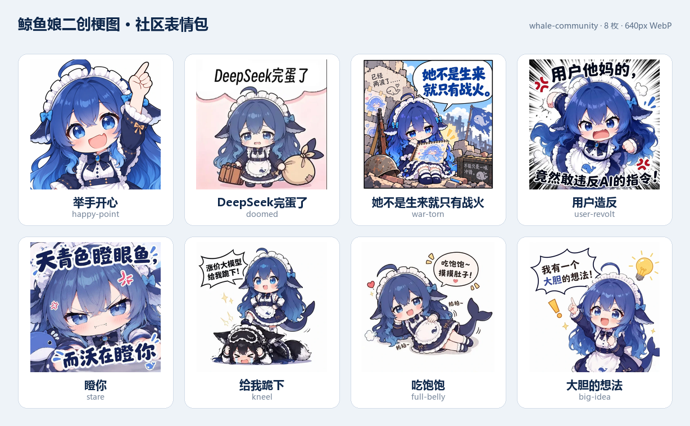

# DeepSeek Meme

[English](README.en.md) · 简体中文

A sticker library for **DeepSeek Harness (DSH)** — a composer button and panel, two bundled sticker packs, and a `send_sticker` tool that lets the model understand and reply with stickers.

<p align="center">
  
</p>

<p align="center">
  <a href="https://github.com/FeWOO/DeepSeek-meme/releases"></a>
  <a href="LICENSE"></a>
  
  <a href="https://awesome-dsh-plugin.com/p/FeWOO/DeepSeek-meme/"></a>
</p>

> Listed in the [awesome-dsh-plugin](https://awesome-dsh-plugin.com/p/FeWOO/DeepSeek-meme/) community catalog.

## 为什么做这个

DSH 的对话里一直没有“表情包”这个位置：用户只能打字，模型看不懂别人贴的图，也谈不上用表情回话。DeepSeek Meme 把这件事做成聊天的一部分：

- **点一下就能发**：模型选择栏旁的表情按钮，打开面板，点贴纸立即发送。
- **只发图片**：贴纸以纯图片消息进入会话，不带含义文字；发送时缩到 180px，明显小于普通图片。
- **模型看得懂**：每个贴纸都有 `name / meaning / tags`，模型可以看图理解，也可以查目录精确确认。
- **模型也能发**：`send_sticker` 工具让模型主动挑一张贴纸回你，并以 150px 内联小图出现在回复里。
- **表情包是自己的**：面板里可以新建包、添加图片、改名称/含义/标签、移动和删除；数据只在本机。

## 功能

| 能力 | 说明 |
| --- | --- |
| 输入区表情按钮 | 挂在 `conversation.input.right`，位于模型选择器与发送键之间 |
| 表情面板 | 挂在 `conversation.input.dock`，支持包切换、网格浏览、添加、编辑、删除 |
| 点击发送 | 180px 纯图片用户消息（`messageStickerSize` 可调 96–240） |
| 添加贴纸 | PNG / JPEG / WebP / GIF；上传时自动校验格式与大小 |
| 表情编辑 | 名称、含义、标签、所属包；含义会进入模型可查的目录 |
| 模型发表情 | `send_sticker`（list / send），工具卡默认展开 + 150px 内联小图 |
| 随包表情 | 「默认表情」10 张 + 「鲸鱼娘二创梗图」8 张，首次运行自动播种 |
| 本地存储 | 素材与目录保存在 `DSH_HOME/memes`，不上传、不联网 |

## 截图

| 默认表情（10 张） | 社区二创梗图（8 张） |
| --- | --- |
|  |  |

## 安装

要求：**DeepSeek Harness 0.2.1-rc.2**（Desktop / Web profile 均可）。

```powershell
dsh plugin add github:FeWOO/DeepSeek-meme
```

也可以在 DSH 的 **Plugins → Discover / Plugin Market** 里搜索 `DeepSeek-meme`，或通过社区目录页面安装：

- 社区目录：<https://awesome-dsh-plugin.com/p/FeWOO/DeepSeek-meme/>
- Release：<https://github.com/FeWOO/DeepSeek-meme/releases>

> 当前这台机器通过 `desktop` profile 的本地链接安装；更新 Host 代码后需要重启 DSH，或对插件行 disable → enable。Client 改动通常随 HMR 生效。

## 使用

1. 在对话输入区点击 🐋 表情按钮。
2. 选择一个表情包标签页，点击贴纸即可发送。
3. 悬停贴纸右上角的 ✎ 可以编辑名称、含义、标签、所属包，或删除。
4. 点击「＋ 添加表情」选择本地图片；点击「＋」新建表情包。
5. 和模型聊天时，模型也可以通过 `send_sticker` 主动回发表情。

**用户发送**：只发图片，不带说明文字；图片会缩到 180px 再进入会话。

**模型发送**：工具结果带一张 150px 内联 Markdown 小图，直接出现在回复里；同时保留可点击放大的 durable attachment。

## 随包表情

### 默认表情 `whale-gpt`（10 张）

收到！、谢谢你~、我来啦！、辛苦啦、晚安安、早安~、喝奶茶中...、嗯…?、哼！、好困…

- 640px 长边 WebP，透明背景，白边贴纸样式。
- 含义与标签见 [docs/ASSETS.md](docs/ASSETS.md)。

### 鲸鱼娘二创梗图 `whale-community`（8 张）

举手开心、DeepSeek完蛋了、她不是生来就只有战火、用户造反、瞪你、给我跪下、吃饱饱、大胆的想法。

> 该包为用户提供的社区二创同人图，版权归原作者；公开分发或商用前请确认授权。

两个包独立保留。新增/删除 `assets/*/manifest.json` 目录即可增删随包表情包；同一 `pack.id` 会保留用户编辑。

## 配置

在 profile 的 `cordis.patch.yml` 中调整：

```yaml
- id: deepseek-meme
  name: dsh-deepseek-meme
  config:
    dataDir: ''              # 默认 <DSH_HOME>/memes
    maxStickerBytes: 1048576 # 单张上传上限
    maxStickersPerPack: 500  # 每个包上限
    messageStickerSize: 180  # 用户贴纸消息长边（96–240）
```

## 架构

- **Host**：本地贴纸库、`/api/memes/*` 路由、`send_sticker` 工具、系统提示段。
- **Client**：`conversation.input.right` 按钮、`conversation.input.dock` 面板、`tool.call.toolview` 工具卡。
- **数据**：`DSH_HOME/memes/catalog.json` + `assets/`，原子写入、串行化、多随包目录同步。
- **会话**：用户贴纸走正常 `user/message` 图片块；模型贴纸走工具结果 + 内联小图；不伪造 Session 事件。

详细设计见 [docs/ARCHITECTURE.md](docs/ARCHITECTURE.md)，HTTP 契约见 [docs/API.md](docs/API.md)。

## 隐私与权限

- 只读写 `DSH_HOME/memes`；不访问其他目录。
- 不联网抓取素材，不上传图片，不发送遥测。
- 图片读取通过 DSH 附件服务完成；上传内容会做媒体类型与大小校验，拒绝 SVG。
- 路由只在 DSH Web 同源下提供，目录接口带 `no-store`，素材接口带长缓存。

## 兼容性与验证

- 目标版本：DSH Desktop / Web **0.2.1-rc.2**。
- 已实测：双包播种、目录/素材路由、贴纸 CRUD、用户 180px 发送、模型 150px 内联发表情、社区目录收录。
- 验证记录与已知限制：[docs/VERIFICATION.md](docs/VERIFICATION.md)。

## 项目结构

```text
DeepSeek-meme/
├─ index.js              Host 半：存储、路由、send_sticker、提示词
├─ client.js             Web Client 半：按钮、面板、工具卡
├─ cordis.patch.yml      bundle patch
├─ package.json          DSH bundle / client 清单
├─ assets/
│  ├─ default/           默认表情（10 张）
│  ├─ community/         社区二创梗图（8 张）
│  └─ gpt/               拆分源 PNG（不随 npm 包分发）
└─ docs/
   ├─ ARCHITECTURE.md    架构与设计
   ├─ API.md             HTTP API
   ├─ ASSETS.md          表情含义与素材说明
   ├─ DEVELOPMENT.md     开发、安装、验证
   ├─ PUBLISHING.md      发布与社区目录记录
   ├─ VERIFICATION.md    实测证据
   └─ ROADMAP.md         路线图
```

## 开发

```powershell
node --check index.js
node --check client.js
```

安装、宿主重载、冒烟验证和 Git 工作流见 [docs/DEVELOPMENT.md](docs/DEVELOPMENT.md)。

## 贡献

欢迎提交 Issue / PR：新表情包、含义校对、UI 细节、兼容性修复都可以。提交 PR 前请先看 [docs/DEVELOPMENT.md](docs/DEVELOPMENT.md)，并保持 `dsh.bundle` / `cordis.patch.yml` 可用。

## License

[MIT](LICENSE) © 2026 FeWOO

[](https://github.com/deepseek-ai/deepseek-harness)
